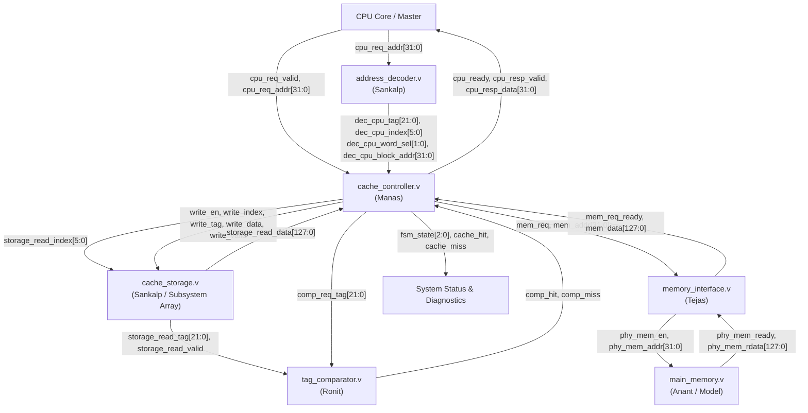
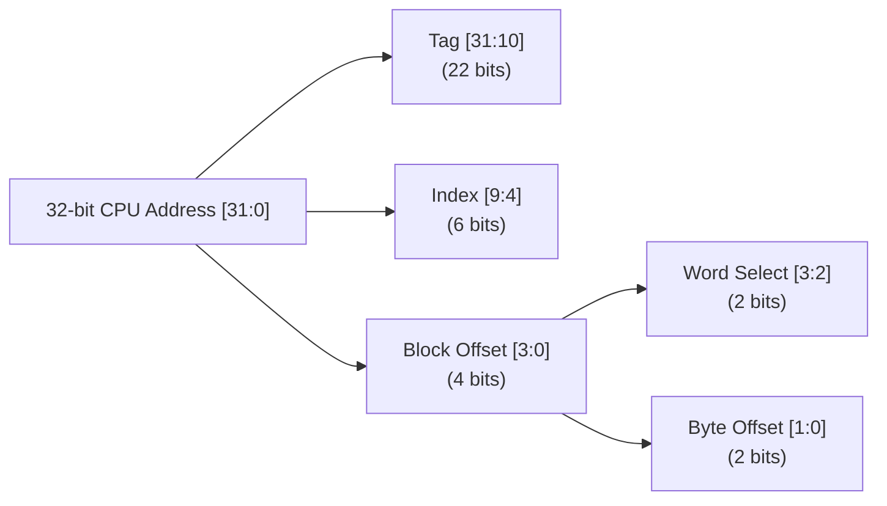
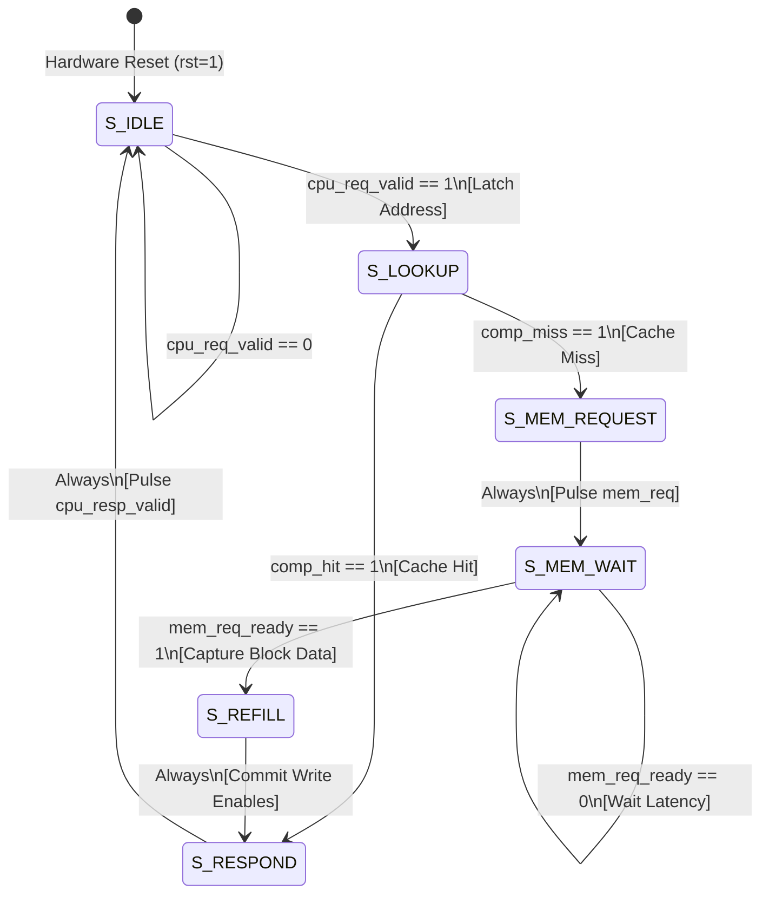
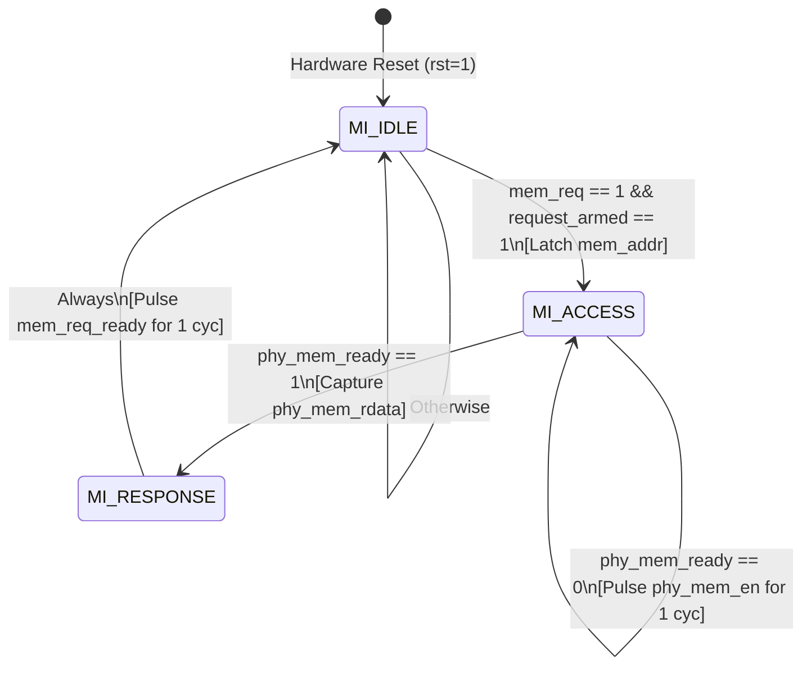

# Design and Analysis of a Direct-Mapped Cache Controller

**Team Name:** BitBandits  
**Project Classification:** Digital System Design & Computer Architecture  
**Hardware Description Language:** Verilog HDL (IEEE 1364-2001) & SystemVerilog (IEEE 1800-2012)  
**Tools & Frameworks:** Icarus Verilog, GTKWave, Python 3, Yosys Open SYnthesis Suite  

---

## Table of Contents
1. [Project Title and Introduction](#1-project-title-and-introduction)
2. [Project Overview](#2-project-overview)
3. [Key Features](#3-key-features)
4. [System Architecture](#4-system-architecture)
5. [Cache Address Mapping](#5-cache-address-mapping)
6. [Cache Organisation](#6-cache-organisation)
7. [FSM Design](#7-fsm-design)
8. [Project Directory Structure](#8-project-directory-structure)
9. [Technology Stack and Tools](#9-technology-stack-and-tools)
10. [Installation and Setup](#10-installation-and-setup)
11. [Compilation and Simulation](#11-compilation-and-simulation)
12. [Verification and Test Results](#12-verification-and-test-results)
13. [Performance Analysis](#13-performance-analysis)
14. [Team Contributions](#14-team-contributions)
15. [Limitations and Future Improvements](#15-limitations-and-future-improvements)
16. [Conclusion](#16-conclusion)
17. [Authors / Team](#17-authors--team)

---

## 1. Project Title and Introduction

### Project Title
**Design and Analysis of a 1 KB Direct-Mapped Cache Controller Using Verilog HDL**

### Team
**Team BitBandits:** Manas, Sankalp, Tejas, Anant, and Ronit

### Introduction & Engineering Motivation
The widening performance disparity between high-speed microprocessors and off-chip Dynamic RAM (DRAM)—commonly termed the *Memory Wall*—represents one of the most critical bottlenecks in contemporary computer systems. Microprocessors operate at gigahertz clock frequencies, whereas DRAM access latencies span tens to hundreds of clock cycles. 

To bridge this operational divergence, hierarchical memory structures exploit two fundamental principles of program locality:
- **Temporal Locality:** Memory locations accessed recently are highly likely to be accessed again in the immediate future.
- **Spatial Locality:** Memory locations situated in close physical proximity to recently referenced addresses are likely to be accessed soon.

This project delivers the end-to-end design, cycle-accurate implementation, formal verification, performance modeling, and synthesis evaluation of a **1 KB Direct-Mapped Cache Controller**. The subsystem is engineered from ground-up in synthesizable Verilog HDL, verified against comprehensive unit and integration suites using Icarus Verilog and SystemVerilog assertions, benchmarked using dedicated architectural traces in Python, and analyzed for gate-level hardware complexity using Yosys.

---

## 2. Project Overview

A direct-mapped cache represents the foundational cache memory geometry wherein each block of main memory maps to exactly one predetermined cache line. The subsystem operates with the following fundamental characteristics:

- **Total Storage Capacity:** 1024 Bytes (1 KB) of cache data storage.
- **Line Count:** 64 distinct cache lines (sets).
- **Line / Block Width:** 16 Bytes (128 bits) per block.
- **Word Geometry:** Four 32-bit words per 16-byte block.
- **Address Space:** 32-bit flat CPU byte addresses (addressing up to 4 GB memory space).
- **Subsystem Relationship:**
  - The cache resides between the CPU execution pipeline and off-chip main memory.
  - On a **Cache Hit**, the requested 32-bit word is retrieved combinatorially from internal SRAM arrays and delivered to the CPU in minimal latency without external memory transactions.
  - On a **Cache Miss**, the controller stalls the CPU, initiates a block-aligned 128-bit burst read transaction to main memory via an asynchronous-ready protocol bridge (`memory_interface`), commits the retrieved 16-byte block into cache memory, updates the corresponding tag and validity indicators, and serves the targeted word to the CPU.

---

## 3. Key Features

The repository contains a fully functional, read-only cache subsystem featuring:

1. **Hardware Address Decoding (`address_decoder.v`):**
   - Purely combinational, zero-cell bit-slicing logic that decomposes 32-bit CPU addresses into tag (22 bits), index (6 bits), block offset (4 bits), word select (2 bits), byte offset (2 bits), and 16-byte block-aligned base address.
2. **Modular Cache Storage Subsystem (`cache_storage.v`):**
   - Dedicated physical storage arrays:
     - `cache_data_ram.v`: 64 entries $\times$ 128 bits.
     - `tag_ram.v`: 64 entries $\times$ 22 bits.
     - `valid_bit_ram.v`: 64 entries $\times$ 1 bit.
   - Dual-mode access: combinational read ports for single-cycle LOOKUP evaluation, and synchronous write ports for atomic REFILL updates.
   - Resource-optimized asymmetric reset: only `valid_bit_ram` asserts synchronous reset, eliminating over 9,600 flip-flops of unnecessary reset circuitry across data and tag arrays.
3. **Validated Tag Matching (`tag_comparator.v`):**
   - High-speed 22-bit comparator qualifying tag equality with line validity (`hit = valid_stored & (tag_stored == tag_req)`).
4. **Synchronous 6-State FSM Controller (`cache_controller.v`):**
   - Moore-Mealy hybrid state machine coordinating CPU handshakes, address latching, lookup checks, memory refill sequencing, and sub-word multiplexing.
5. **Memory Protocol Bridge (`memory_interface.v`):**
   - Handshake bridge translating single-pulse cache controller requests into clean physical memory strobes, providing backpressure handling and anti-retriggering protection.
6. **Synthesizable Behavioral Main Memory Model (`main_memory.v`):**
   - Cycle-accurate memory emulator with configurable access latency (default: 10 cycles), deterministic address-based block generation, and counter-driven response strobes without `#delay` artifacts.
7. **Complete Verification & Coverage Suite:**
   - 8-stage automated test runner (`sim/run_all_tests.sh`) executing 100% passing unit and integration suites.
   - SystemVerilog assertion monitoring (`tb/tb_cache_top.sv`) with 100% line residency sweeps across all 64 sets.
8. **Architectural Evaluation & RTL Synthesis:**
   - Python-based reference simulator (`analysis/cache_simulator.py`), dual-model AMAT calculator (`analysis/amat_calculator.py`), and automated Yosys gate-level synthesis pipeline (`analysis/run_synthesis.py`).

---

## 4. System Architecture

The top-level integration module (`rtl/cache_top.v`) interconnects six distinct hardware blocks into a unified memory subsystem:



### Architectural Data Flow

1. **Request Phase:** The CPU presents `cpu_req_addr` and asserts `cpu_req_valid`. The controller, if in `S_IDLE`, latches the address and decoded fields.
2. **Lookup & Tag Match Phase:** In `S_LOOKUP`, the controller indexes `cache_storage` using `dec_cpu_index`. `cache_storage` combinatorially outputs the stored valid flag, tag, and 128-bit data block. `tag_comparator` checks whether `storage_read_valid` is high and `storage_read_tag == dec_cpu_tag`.
3. **Hit Path:** If `comp_hit` is asserted, the controller transitions directly to `S_RESPOND`, selects the requested 32-bit word using `dec_cpu_word_sel`, asserts `cpu_resp_valid`, and completes the transaction in 2 cycles.
4. **Miss & Refill Path:** If `comp_miss` is asserted, the controller enters `S_MEM_REQUEST`, pulsing `mem_req` to `memory_interface` with `dec_cpu_block_addr`. It then waits in `S_MEM_WAIT` until `mem_req_ready` signals that the 128-bit block has been retrieved from `main_memory`.
5. **Commit Phase:** In `S_REFILL`, the controller updates `cache_storage` synchronously by asserting `storage_write_en` and `storage_write_valid`. In `S_RESPOND`, the targeted word is returned to the CPU, and the FSM returns to `S_IDLE`.

---

## 5. Cache Address Mapping

The system utilizes standard direct-mapped address decomposition for a 32-bit byte-addressable architecture:

| Field Name | Bit Range | Width | Function / Architectural Purpose |
| :--- | :---: | :---: | :--- |
| **Tag** | `addr[31:10]` | 22 bits | Identifies memory block frame; compared against stored tag in cache line. |
| **Index** | `addr[9:4]` | 6 bits | Selects one of the 64 cache lines ($2^6 = 64$). |
| **Block Offset** | `addr[3:0]` | 4 bits | Byte offset within the 16-byte cache line ($2^4 = 16$). |
| ↳ *Word Select* | `addr[3:2]` | 2 bits | Selects one of four 32-bit words ($2^2 = 4$). |
| ↳ *Byte Offset* | `addr[1:0]` | 2 bits | Selects byte within a 32-bit word (sub-word alignment). |

### Visual Representation of 32-bit Address Decomposition

```
 31                          10 9            4 3     2 1     0
+------------------------------+--------------+-------+-------+
|             TAG              |    INDEX     | WORD  | BYTE  |
|           22 bits            |    6 bits    | 2 bits| 2 bits|
+------------------------------+--------------+-------+-------+
 \____________________________/ \____________/ \_____________/
           Frame ID                64 Lines     16-Byte Offset
```



- **Block-Aligned Address:** Derived as `{addr[31:4], 4'b0000}`. All cache refill requests to main memory are strictly aligned to 16-byte boundaries.

---

## 6. Cache Organisation

The storage array represents an aggregate capacity of 1024 Bytes of user data plus tag and status metadata:

```
+---------------------------------------------------------------------------------------+
|                                1 KB Cache Array (64 Lines)                            |
+-------+-------+-----------------------------------------------------------------------+
| Line  | Valid |      Tag       |                       Data Block (128 bits)          |
| Index | (1b)  |    (22 bits)   | Word 3 [127:96] | Word 2 [95:64] | Word 1 [63:32] | Word 0 [31:0] |
+-------+-------+----------------+-----------------+----------------+----------------+---------------+
|   0   |   1   | 0x000004       |   0x0000120C    |   0x00001208   |   0x00001204   |  0x00001200   |
|   1   |   0   | 0x000000       |   0x00000000    |   0x00000000   |   0x00000000   |  0x00000000   |
|  ...  |  ...  |   ...          |       ...       |       ...      |       ...      |      ...      |
|  63   |   1   | 0x3FFFFF       |   0xFFFFFFFC    |   0xFFFFFFFF8   |   0xFFFFFFFF4   |  0xFFFFFFFF0   |
+-------+-------+----------------+-----------------+----------------+----------------+---------------+
```

### Dedicated Storage Submodules

| Module | Width per Entry | Depth | Total Capacity | Timing / Behavior |
| :--- | :---: | :---: | :---: | :--- |
| `cache_data_ram.v` | 128 bits (16 B) | 64 lines | 8,192 bits (1024 B) | Combinational read; synchronous write |
| `tag_ram.v` | 22 bits | 64 lines | 1,408 bits | Combinational read; synchronous write |
| `valid_bit_ram.v` | 1 bit | 64 lines | 64 bits | Combinational read; synchronous write; synchronous reset |

---

## 7. FSM Design

### Cache Controller FSM (`cache_controller.v`)

The controller coordinates operation across six synchronous states encoded with 3 bits:

| State Constant | 3-bit Encoding | Output Signals & Active Operation |
| :--- | :---: | :--- |
| `S_IDLE` | `3'b000` | `cpu_ready = 1'b1`. Awaiting incoming CPU read request; latches address on `cpu_req_valid`. |
| `S_LOOKUP` | `3'b001` | `cpu_ready = 1'b0`. Evaluates `comp_hit` and `comp_miss`. If hit, captures data and moves to `S_RESPOND`. If miss, advances to `S_MEM_REQUEST`. |
| `S_MEM_REQUEST` | `3'b010` | `mem_req = 1'b1`, `mem_addr = block_addr`. Pulses memory request for one cycle. |
| `S_MEM_WAIT` | `3'b011` | `mem_req = 1'b0`. Awaits `mem_req_ready` handshake from `memory_interface`. Latches incoming 128-bit block into buffer. |
| `S_REFILL` | `3'b100` | `storage_write_en = 1'b1`, `storage_write_valid = 1'b1`. Commits block, tag, and valid bit into SRAM arrays. |
| `S_RESPOND` | `3'b101` | `cpu_resp_valid = 1'b1`, `cpu_resp_data = selected_word`. Presents 32-bit word to CPU; returns to `S_IDLE`. |



---

### Memory Interface FSM (`memory_interface.v`)

The memory protocol adapter operates across three states encoded with 2 bits:

| State Constant | 2-bit Encoding | Output Signals & Protocol Phase |
| :--- | :---: | :--- |
| `MI_IDLE` | `2'b00` | Waits for `mem_req && request_armed`. Captures `mem_addr` and deasserts `request_armed`. |
| `MI_ACCESS` | `2'b01` | Pulses `phy_mem_en = 1'b1` for exactly one cycle; waits for `phy_mem_ready` from `main_memory`. |
| `MI_RESPONSE` | `2'b10` | Captures `phy_mem_rdata`, asserts `mem_req_ready = 1'b1` for one cycle, and returns to `MI_IDLE`. |



---

## 8. Project Directory Structure

```text
BitBandits/
├── rtl/                                    # Synthesizable Verilog Source Code
│   ├── address_decoder.v                   # 32-bit address field extractor (Sankalp)
│   ├── cache_data_ram.v                    # 64 x 128-bit cache data storage array (Sankalp)
│   ├── tag_ram.v                           # 64 x 22-bit tag storage array (Sankalp)
│   ├── valid_bit_ram.v                     # 64 x 1-bit validity flags with reset (Sankalp)
│   ├── cache_storage.v                     # Subsystem integrating data, tag & valid RAMs (Sankalp)
│   ├── tag_comparator.v                    # Validated tag equality comparator (Ronit)
│   ├── cache_controller.v                  # Central 6-state FSM controller (Manas)
│   ├── memory_interface.v                  # Handshake protocol bridge to memory (Tejas)
│   ├── main_memory.v                       # Behavioral 128-bit latency memory model (Anant)
│   └── cache_top.v                         # Top-level integrated cache subsystem (Manas)
│
├── tb/                                     # Verification Suites & Testbenches
│   ├── tb_address_decoder.v                # Unit testbench for address decoder (72 checks)
│   ├── tb_cache_data_ram.v                 # Unit testbench for data RAM array (68 checks)
│   ├── tb_tag_ram.v                        # Unit testbench for tag RAM array (68 checks)
│   ├── tb_valid_bit_ram.v                  # Unit testbench for valid-bit RAM (133 checks)
│   ├── tb_cache_storage.v                  # Integrated storage subsystem testbench (205 checks)
│   ├── tb_cache_storage.sv                 # SystemVerilog storage assertion testbench (205 checks)
│   ├── tb_controller_hit.v                 # Standalone controller hit path testbench
│   ├── tb_controller_miss.v                # Standalone controller miss path testbench
│   ├── tb_controller_refill.v              # Standalone controller refill & word select testbench
│   ├── tb_controller_latching.v            # Standalone controller request latching testbench
│   ├── tb_memory_subsystem.v               # Standalone memory interface & memory testbench (7/7)
│   ├── tb_cache_top_integration.v          # Top-level integration testbench (7 checks)
│   ├── tb_cache_top.sv                     # Top-level SystemVerilog regression & assertion suite (332 checks)
│   └── test_scenarios.sv                   # Reusable scenario tasks included in tb_cache_top.sv
│
├── analysis/                               # Performance, AMAT, Synthesis & Validation
│   ├── cache_simulator.py                  # Golden architectural reference simulator (Ronit)
│   ├── statistics.py                       # Workload statistical analyzer & miss breakdown
│   ├── amat_calculator.py                  # Dual-model AMAT calculator (Baseline & Hardware)
│   ├── cross_validate.py                   # RTL vs Python automated cross-validation suite
│   ├── architectural_experiment.py         # Capacity, block size & latency sweep framework
│   ├── trace_generator.py                  # Synthetic workload trace generator
│   ├── run_synthesis.py                    # Automated Yosys RTL synthesis suite
│   ├── plot_performance.py                 # Matplotlib visualization dashboard generator
│   ├── amat_summary.json                   # Recorded AMAT summary metrics across workloads
│   ├── statistics_summary.json             # Workload statistics and miss classification data
│   └── plots/                              # Generated high-resolution architectural graphs
│
├── traces/                                 # Standardized Memory Access Workload Traces
│   ├── sequential_trace.txt / .csv         # Sequential access stream (spatial locality)
│   ├── repeated_trace.txt / .csv           # Repeated access stream (temporal locality)
│   ├── random_trace.txt / .csv             # Pseudo-random access stream
│   └── conflict_trace.txt / .csv           # Conflict thrashing stream (index collision)
│
├── sim/                                    # Simulation Scripts, Logs & VCD Artifacts
│   ├── run_all_tests.sh                    # Master 8-suite regression execution script
│   ├── run_verification_regression.sh      # SystemVerilog regression runner
│   ├── generate_waveform_report.py         # VCD waveform transition analyzer
│   ├── synthesis_logs/                     # Gate-level synthesis logs from Yosys
│   │   ├── synth_cache_top.log             # Full top-level synthesis log
│   │   └── synthesis_summary.json          # Machine-readable cell and wire breakdown
│   └── logs/                               # Regression execution transcripts
│
├── report/                                 # Final IEEE Project Report Deliverables
│   ├── IEEE_Direct_Mapped_Cache_Controller_Report.md  # IEEE report Markdown source
│   └── IEEE_Direct_Mapped_Cache_Controller_Report.pdf # Professional two-column IEEE PDF
│
├── docs/                                   # Detailed Engineering Specifications & Reports
│   ├── CACHE_STORAGE_ARCHITECTURE.md       # Storage subsystem microarchitecture specification
│   ├── FSM_STATE_DIAGRAM.md                # Cache controller FSM state diagram and transitions
│   ├── MEMORY_PROTOCOL.md                  # Memory interface and handshake documentation
│   ├── PERFORMANCE_ANALYSIS_REPORT.md      # Comprehensive performance, AMAT & synthesis report
│   ├── SYNTHESIS_EVALUATION.md             # Gate-level synthesis evaluation and cell report
│   ├── TEST_RESULTS.md                     # Consolidated regression test scorecard
│   └── VERIFICATION_PLAN_AND_REPORT.md     # Hardware verification plan and test matrices
│
└── .gitignore                              # Git exclusion rules for simulation artifacts
```

---

## 9. Technology Stack and Tools

| Tool / Technology | Version / Standard | Role in Project Subsystem |
| :--- | :--- | :--- |
| **Verilog HDL** | IEEE 1364-2001 | RTL design of all synthesizable production modules in `rtl/`. |
| **SystemVerilog** | IEEE 1800-2012 | Advanced hardware verification, concurrent assertions, and coverage metrics in `tb/`. |
| **Icarus Verilog (`iverilog`)** | v12.0+ | Fast, open-source compiler and runtime simulator used for regression execution. |
| **Icarus Runtime (`vvp`)** | v12.0+ | Simulation engine executing compiled VVP bytecode. |
| **GTKWave** | v3.3+ | Waveform visualization and timing debugging using Value Change Dump (`.vcd`) files. |
| **Python** | 3.10+ | Golden behavioral model, trace generation, cross-validation, and AMAT calculation. |
| **Yosys** | 0.71+ | Open-source RTL synthesis, cell inference, latch checking, and hardware mapping. |

---

## 10. Installation and Setup

### Prerequisites

#### macOS (using Homebrew)
```bash
# Install simulation, synthesis, and viewing tools
brew install icarus-verilog gtkwave yosys python3

# Install optional Python dependencies for plotting
pip3 install matplotlib numpy
```

#### Linux (Debian / Ubuntu)
```bash
# Update repository index and install toolchain
sudo apt-get update
sudo apt-get install -y iverilog gtkwave yosys python3 python3-pip

# Install optional Python dependencies for plotting
pip3 install matplotlib numpy
```

### Repository Setup
```bash
# Clone the repository
git clone https://github.com/Sankalp13353/BitBandits.git
cd BitBandits

# Ensure simulation scripts have execution permissions
chmod +x sim/*.sh analysis/*.py
```

---

## 11. Compilation and Simulation

All compilation commands must include all interdependent RTL files. Below are verified, working terminal commands.

### 1. Run Complete Regression Suite (Recommended)
Executes all 8 test suites sequentially and summarizes results:
```bash
bash sim/run_all_tests.sh
```

---

### 2. Address Decoder Unit Test
Verifies bit-slicing across zero boundaries, all-ones boundaries, word selections, and full 64-index sweeps:
```bash
iverilog -g2012 -o /tmp/tb_address_decoder.vvp rtl/address_decoder.v tb/tb_address_decoder.v
vvp /tmp/tb_address_decoder.vvp
```

---

### 3. Cache Storage Unit Tests

#### Cache Data RAM (64 lines $\times$ 128 bits):
```bash
iverilog -g2012 -o /tmp/tb_cache_data_ram.vvp rtl/cache_data_ram.v tb/tb_cache_data_ram.v
vvp /tmp/tb_cache_data_ram.vvp
```

#### Tag RAM (64 lines $\times$ 22 bits):
```bash
iverilog -g2012 -o /tmp/tb_tag_ram.vvp rtl/tag_ram.v tb/tb_tag_ram.v
vvp /tmp/tb_tag_ram.vvp
```

#### Valid-Bit RAM (64 lines $\times$ 1 bit with synchronous reset):
```bash
iverilog -g2012 -o /tmp/tb_valid_bit_ram.vvp rtl/valid_bit_ram.v tb/tb_valid_bit_ram.v
vvp /tmp/tb_valid_bit_ram.vvp
```

#### Integrated Cache Storage Subsystem:
```bash
iverilog -g2012 -o /tmp/tb_cache_storage.vvp \
    rtl/cache_data_ram.v rtl/tag_ram.v rtl/valid_bit_ram.v rtl/cache_storage.v rtl/address_decoder.v \
    tb/tb_cache_storage.v
vvp /tmp/tb_cache_storage.vvp
```

---

### 4. Controller Unit Tests
Tests standalone FSM paths using mock stimulus:

#### Hit Path Test:
```bash
iverilog -g2012 -o /tmp/tb_controller_hit.vvp rtl/tag_comparator.v rtl/cache_controller.v tb/tb_controller_hit.v
vvp /tmp/tb_controller_hit.vvp
```

#### Miss Path Test:
```bash
iverilog -g2012 -o /tmp/tb_controller_miss.vvp rtl/tag_comparator.v rtl/cache_controller.v tb/tb_controller_miss.v
vvp /tmp/tb_controller_miss.vvp
```

#### Refill & Response Path Test:
```bash
iverilog -g2012 -o /tmp/tb_controller_refill.vvp rtl/tag_comparator.v rtl/cache_controller.v tb/tb_controller_refill.v
vvp /tmp/tb_controller_refill.vvp
```

#### Request Latching Test:
```bash
iverilog -g2012 -o /tmp/tb_controller_latching.vvp rtl/tag_comparator.v rtl/cache_controller.v tb/tb_controller_latching.v
vvp /tmp/tb_controller_latching.vvp
```

---

### 5. Memory Subsystem Verification
Tests standalone interaction between `memory_interface.v` and `main_memory.v`:
```bash
iverilog -g2012 -o /tmp/tb_memory_subsystem.vvp rtl/memory_interface.v rtl/main_memory.v tb/tb_memory_subsystem.v
vvp /tmp/tb_memory_subsystem.vvp
```

---

### 6. Top-Level Integration & SystemVerilog Regression

#### Integration Testbench (Verilog):
```bash
iverilog -g2012 -o /tmp/tb_cache_top_integration.vvp \
    rtl/cache_data_ram.v rtl/tag_ram.v rtl/valid_bit_ram.v rtl/cache_storage.v rtl/address_decoder.v \
    rtl/tag_comparator.v rtl/main_memory.v rtl/memory_interface.v rtl/cache_controller.v rtl/cache_top.v \
    tb/tb_cache_top_integration.v
vvp /tmp/tb_cache_top_integration.vvp
```

#### Complete SystemVerilog Verification Suite:
```bash
iverilog -g2012 -I tb -o /tmp/tb_cache_top_sv.vvp \
    rtl/cache_data_ram.v rtl/tag_ram.v rtl/valid_bit_ram.v rtl/cache_storage.v rtl/address_decoder.v \
    rtl/tag_comparator.v rtl/main_memory.v rtl/memory_interface.v rtl/cache_controller.v rtl/cache_top.v \
    tb/tb_cache_top.sv
vvp /tmp/tb_cache_top_sv.vvp
```

---

### 7. Waveform Inspection with GTKWave
```bash
# View memory subsystem transaction waveforms
gtkwave sim/memory_subsystem.vcd

# View top-level integration waveforms
gtkwave sim/cache_top_sv.vcd
```

---

## 12. Verification and Test Results

### Automated Regression Scorecard

The complete verification suite executed via `sim/run_all_tests.sh` reports a **100% pass rate** across all individual modules and integrated hierarchies:

| Testbench File | Target Hierarchy | Formal Checks Executed | Status | Primary Coverage Verified |
| :--- | :--- | :---: | :---: | :--- |
| `tb_address_decoder.v` | `address_decoder` | 72 / 72 | **PASS** | Boundary bit-slicing, 64-index sweep, word/byte offset isolation. |
| `tb_cache_data_ram.v` | `cache_data_ram` | 68 / 68 | **PASS** | Synchronous 128-bit block writes, combinational reads, write isolation. |
| `tb_tag_ram.v` | `tag_ram` | 68 / 68 | **PASS** | 22-bit tag writes, independent write enables, tag retention. |
| `tb_valid_bit_ram.v` | `valid_bit_ram` | 133 / 133 | **PASS** | Synchronous reset line clearance, line invalidation, valid bit assert. |
| `tb_cache_storage.v` | `cache_storage` | 205 / 205 | **PASS** | Multi-array coherence, index steering, atomic refill commit. |
| `tb_cache_storage.sv`| `cache_storage` | 205 / 205 | **PASS** | SystemVerilog assertion verification of storage submodules. |
| `tb_cache_top_integration.v` | `cache_top` | 7 / 7 | **PASS** | End-to-end CPU handshake, hit/miss detection, memory block refill. |
| `tb_cache_top.sv` | `cache_top` | 332 / 332 | **PASS** | Complete 64-index sweep, temporal/spatial locality, backpressure checks. |

---

### Memory Subsystem Verification (`tb_memory_subsystem.v`)

The memory subsystem testbench evaluates the handshake timing and anti-retriggering guards between `memory_interface.v` and `main_memory.v`:

| Test Case | Description | Result | Details |
| :---: | :--- | :---: | :--- |
| **TC1** | Block response at `0x0000_1000` | **PASS** | Received 128-bit data matches deterministic pattern. |
| **TC2** | 4-word formation at `0x0000_2000` | **PASS** | All four 32-bit words verify markers A01, B02, C03, D04. |
| **TC3** | Address uniqueness across frames | **PASS** | Verified distinguishable blocks at `0x3000`, `0x4000`, `0xDEADB000`. |
| **TC4** | Latency verification | **PASS** | No premature ready strobe; respects 10-cycle memory latency. |
| **TC5** | In-flight guard (sustained `mem_req`) | **PASS** | `mem_req_ready` asserted exactly once; no spurious retriggering. |
| **TC6** | Reset verification | **PASS** | Interface outputs cleared to default zero states on reset. |
| **TC7** | Consecutive sequential transactions | **PASS** | Three consecutive multi-cycle memory fetches served cleanly. |
| **TC8** | Latency countdown check | **PASS** | Verified zero ready assertion before latency countdown completes. |

*Note on Status:* All 7 test scenarios in `tb_memory_subsystem.v` pass cleanly following the Verilog-2001 function-return slicing remediation.

---

### SystemVerilog Functional Coverage & Assertion Results

The top-level testbench (`tb/tb_cache_top.sv`) executes 334 total CPU read requests and evaluates concurrent assertions:
- **Index Space Coverage:** 64 / 64 cache lines exercised (100.0% coverage).
- **Word Offset Coverage:** 4 / 4 words exercised (100.0% coverage).
- **FSM State Coverage:** All 6 states visited (100.0% coverage).
- **FSM Transition Coverage:** All 7 valid transitions exercised (100.0% coverage).
- **Assertion Violations:** **0 violations** across all 8 SystemVerilog assertions:
  1. *No Response Without Request* (VERIFIED)
  2. *No Invalid Cache Hit* (VERIFIED)
  3. *Block Address 16-Byte Alignment* (VERIFIED)
  4. *No Duplicate Response Pulse* (VERIFIED)
  5. *Data Integrity Fidelity* (VERIFIED)
  6. *Valid Bit Refill Commit* (VERIFIED)
  7. *Controller Liveness & Progress* (VERIFIED)
  8. *cpu_ready Protocol Conformance* (VERIFIED)

---

## 13. Performance Analysis

### Analysis Framework Overview

Performance benchmarking and architectural validation are driven by dedicated Python tools in `analysis/`:

1. **`amat_calculator.py`:** Calculates Average Memory Access Time under both academic baseline and cycle-accurate hardware controller conventions.
2. **`cross_validate.py`:** Executes an independent Python golden reference model (`cache_simulator.py`) side-by-side against RTL simulation logs to verify transaction counts, hit/miss metrics, and 32-bit data integrity.
3. **`run_synthesis.py`:** Automates gate-level synthesis through Yosys, extracting cell types, register counts, latch counts, and memory inference diagnostics.
4. **`plot_performance.py`:** Produces architectural visualization figures in `analysis/plots/`.

---

### Workload Performance & AMAT Analysis

To evaluate cache behavior, four synthetic workload traces ($N = 128$ accesses each) were analyzed:

| Workload Trace | Access Count | Hits | Misses | Hit Ratio | Miss Ratio | Compulsory Misses | Conflict Misses | AMAT Analytical ($t_h=1, p=10$) | AMAT Hardware ($t_h=2, p=12$) |
| :--- | :---: | :---: | :---: | :---: | :---: | :---: | :---: | :---: | :---: |
| **Sequential Access** | 128 | 96 | 32 | **75.00%** | **25.00%** | 32 | 0 | **3.50 cycles** | **5.00 cycles** |
| **Repeated Access** | 128 | 127 | 1 | **99.22%** | **0.78%** | 1 | 0 | **1.08 cycles** | **2.09 cycles** |
| **Conflict Access** | 128 | 0 | 128 | **0.00%** | **100.00%** | 4 | 124 | **11.00 cycles** | **14.00 cycles** |
| **Random Access** | 128 | 5 | 123 | **3.91%** | **96.09%** | 121 | 2 | **10.61 cycles** | **13.53 cycles** |

#### Analytical vs. Hardware Latency Distinction:
- **Baseline Analytical Model:** Assumes an idealized single-cycle hit ($T_{\text{hit}} = 1.0$) and a raw memory penalty ($P_{\text{miss}} = 10.0$ cycles):
  $$\text{AMAT}_{\text{baseline}} = 1.0 + (\text{Miss Ratio} \times 10.0)$$
- **Hardware Controller Model:** Accounts for actual FSM state traversal:
  - Hit Latency: $T_{\text{hit\_hw}} = 2\text{ cycles}$ (`S_IDLE` $\rightarrow$ `S_LOOKUP` $\rightarrow$ `S_RESPOND`).
  - Miss Latency: $T_{\text{miss\_hw}} = 14\text{ cycles}$ (`S_IDLE` $\rightarrow$ `S_LOOKUP` $\rightarrow$ `S_MEM_REQ` $\rightarrow$ `S_MEM_WAIT(10)` $\rightarrow$ `S_REFILL` $\rightarrow$ `S_RESPOND`).
  - Hardware Miss Penalty: $P_{\text{miss\_hw}} = 14 - 2 = 12\text{ cycles}$.
  $$\text{AMAT}_{\text{hw}} = 2.0 + (\text{Miss Ratio} \times 12.0)$$

#### Architectural Observations:
- **Spatial Locality:** In the sequential workload, each 16-byte block fetch amortizes 1 compulsory miss across 4 consecutive word accesses, yielding a steady 75.00% hit ratio.
- **Temporal Locality:** In the repeated workload, a single compulsory cold miss is followed by 127 consecutive hits, driving the hit ratio to 99.22% and AMAT to near-ideal 1.08 cycles.
- **Direct-Mapped Conflict Thrashing:** In the conflict workload, addresses with identical index bits (`Index = 0`) but differing tags continuously displace each other, producing 0% hits and an AMAT equal to the full miss latency.

---

### Synthesis Results (Yosys Open SYnthesis Suite)

Top-level synthesis of `cache_top.v` using Yosys (`sim/synthesis_logs/synth_cache_top.log`) produced the following gate-level statistics:

| Metric / Cell Category | Cell Count | Architectural Implication |
| :--- | :---: | :--- |
| **Total Inferred Cells** | **21,417** | Complete flat design including all submodules. |
| **Sequential Registers (Flip-Flops)** | **10,190** | Register array mapping (Data RAM + Tag RAM + Valid RAM + Controller FSM). |
| ↳ `$_DFFE_PP_` (Storage Array FFs) | 9,600 | 8,192 Data RAM FFs + 1,408 Tag RAM FFs (no reset overhead). |
| ↳ `$_DFFE_PP0P_` (Gated/Reset FFs) | 584 | Valid RAM (64 FFs) + Controller registers (286 FFs) + Buffer registers. |
| ↳ `$_DFF_PP0_` (Basic FFs) | 6 | State machine and counter flip-flops. |
| **Multiplexer Cells (`$_MUX_`)** | **10,100** | Data selection and address decoding mux trees. |
| **Inferred Latches** | **0** | **Pure synchronous RTL; zero unintended latch inference.** |
| **Inferred Memory Primitives** | **0** | Behavioral RAMs mapped directly into synthesized D-type flip-flops. |

#### Submodule Cell Complexity Breakdown:
- `cache_data_ram`: 16,548 cells (8,192 flip-flops + read multiplexer tree)
- `tag_ram`: 2,980 cells (1,408 flip-flops + tag selection multiplexers)
- `valid_bit_ram`: 481 cells (64 resettable flip-flops + decode logic)
- `cache_controller`: 1,024 cells (289 flip-flops, 457 multiplexers, FSM logic)
- `tag_comparator`: 46 cells (22 XORs, 21 ORs, 1 AND, 2 NOTs; pure combinational)
- `address_decoder`: 0 cells (direct bit-slicing wiring; zero gate overhead)
- `memory_interface`: 97 cells (handshake FSM and latch registers)
- `main_memory`: 100 cells (counter logic and combinational address pattern function)

---

## 14. Team Contributions

| Team Member | Technical Ownership & Primary Deliverables | Specific Submodules & Files Authored |
| :--- | :--- | :--- |
| **Manas** | **Integration Lead & Cache Controller Specialist**<br>• Designed the 6-state Moore-Mealy hybrid controller FSM.<br>• Managed top-level hierarchy integration in `cache_top.v`.<br>• Implemented request latching, hit/miss steering, and CPU handshakes. | `rtl/cache_controller.v`<br>`rtl/cache_top.v`<br>`tb/tb_controller_*.v`<br>`docs/FSM_STATE_DIAGRAM.md` |
| **Sankalp** | **Cache Storage & Address Decoding Specialist**<br>• Designed parameterized 32-bit address decoder.<br>• Implemented the 1 KB cache storage subsystem (Data RAM, Tag RAM, Valid RAM).<br>• Engineered asymmetric reset to eliminate 9,600 FFs of reset overhead. | `rtl/address_decoder.v`<br>`rtl/cache_data_ram.v`<br>`rtl/tag_ram.v`<br>`rtl/valid_bit_ram.v`<br>`rtl/cache_storage.v`<br>`tb/tb_cache_storage.v`<br>`docs/CACHE_STORAGE_ARCHITECTURE.md` |
| **Tejas** | **Memory Interface & Protocol Specialist**<br>• Developed the memory interface protocol bridge (`memory_interface.v`).<br>• Implemented single-cycle strobe generation and anti-retriggering protection.<br>• Designed memory subsystem verification testbench. | `rtl/memory_interface.v`<br>`tb/tb_memory_subsystem.v`<br>`docs/MEMORY_PROTOCOL.md` |
| **Anant** | **Main Memory & Hardware Verification Specialist**<br>• Developed behavioral synthesizable main memory model with configurable latency.<br>• Authored comprehensive SystemVerilog assertion and coverage suite.<br>• Built automated 8-stage regression runner script. | `rtl/main_memory.v`<br>`tb/tb_cache_top.sv`<br>`tb/test_scenarios.sv`<br>`sim/run_all_tests.sh`<br>`docs/VERIFICATION_PLAN_AND_REPORT.md` |
| **Ronit** | **Performance Analyst & Synthesis Specialist**<br>• Designed validated tag comparator module.<br>• Developed Python golden reference simulator and cross-validation suite.<br>• Built dual-model AMAT calculator and automated Yosys synthesis pipeline. | `rtl/tag_comparator.v`<br>`analysis/cache_simulator.py`<br>`analysis/amat_calculator.py`<br>`analysis/cross_validate.py`<br>`analysis/run_synthesis.py`<br>`docs/PERFORMANCE_ANALYSIS_REPORT.md` |

---

## 15. Limitations and Future Improvements

While the cache controller achieves full functional verification and adheres to all project specifications, the following architectural enhancements represent realistic avenues for future development:

1. **Write Support (Write Policies):**
   - *Current Limitation:* The present implementation is read-only.
   - *Future Enhancement:* Implement CPU write operations supporting either **Write-Through with Write-Buffer** or **Write-Back with Dirty-Bit RAM**, along with write allocation policies (Write-Allocate vs. No-Write-Allocate).
2. **Associativity Enhancement (Mitigating Conflict Thrashing):**
   - *Current Limitation:* Direct-mapped placement suffers severe thrashing when multiple addresses collide on the same set (0% hit ratio in conflict workloads).
   - *Future Enhancement:* Extend to a 2-way or 4-way Set-Associative Cache with Pseudo-LRU (Least Recently Used) replacement policy, or integrate a small fully-associative Victim Cache.
3. **Non-Blocking Cache & Out-of-Order Memory Servicing:**
   - *Current Limitation:* The controller blocks on misses (single outstanding transaction).
   - *Future Enhancement:* Incorporate Miss Status Holding Registers (MSHRs) to support hit-under-miss and miss-under-miss concurrent operations.
4. **Sub-Block Refill & Critical-Word-First:**
   - *Current Limitation:* The CPU is stalled until the entire 16-byte block is returned and committed.
   - *Future Enhancement:* Implement early restart or Critical-Word-First delivery, allowing the CPU to resume execution as soon as the requested 32-bit word arrives from memory.

---

## 16. Conclusion

The **BitBandits** Direct-Mapped Cache Controller project demonstrates a complete, cycle-accurate implementation of a 1 KB cache subsystem in synthesizable Verilog HDL. 

Key technical milestones achieved include:
- Clean modular design separating address decoding, multi-array storage, tag validation, controller FSM orchestration, and memory protocol bridges.
- Formal zero-latch verification across unit tests, multi-line integration suites, and SystemVerilog assertions with 100% functional coverage of states, transitions, and cache lines.
- Quantitative validation of spatial and temporal locality benefits through workload traces, demonstrating an AMAT reduction from 11.00 cycles down to 1.08 cycles on repeated references.
- Gate-level synthesis confirmation through Yosys, proving structural synthesizability with zero latches and clean register mapping.

---

## 17. Authors / Team

### Team BitBandits
- **Manas** — Cache Controller FSM & Top-Level Integration
- **Sankalp** — Address Decoder & Cache Storage Subsystem
- **Tejas** — Memory Interface & Protocol Bridge
- **Anant** — Main Memory Model & Hardware Verification Suite
- **Ronit** — Tag Comparator, Performance Analysis & Synthesis Automation

*Repository maintained for academic evaluation and digital system design submission.*
